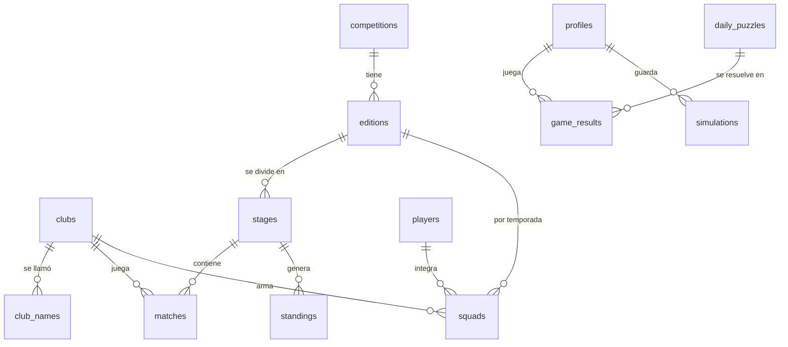

# Modelo de datos

**Borrador v0.** Dueño: Pela. Lo valida el grupo en la Fase 0 y se convierte en el esquema real de `supabase/schemas/`. Cada cambio al esquema actualiza este archivo en el mismo PR.

La idea central: **un formato de competición es un dato**. La misma configuración describe la Primera 2026 real y una liga inventada del simulador, y el mismo motor (`packages/core`) calcula sus tablas.



## Tablas núcleo

| Tabla | Qué guarda | Detalle clave |
| --- | --- | --- |
| `clubs` | Club con identidad estable | Un club es el mismo aunque cambie de nombre |
| `club_names` | Nombres de un club en el tiempo | Vigencia desde/hasta: cambios de nombre, fusiones, clubes desaparecidos |
| `competitions` | Primera División, Primera Nacional, B Metro... | Nivel (1, 2, 3), país, región, si está activa |
| `editions` | Una edición: "Primera 2026", "Apertura 1995", "Metropolitano 1975" | Soporta torneos cortos y temporadas de calendario o partidas (2024/25) |
| `stages` | Fases dentro de una edición | Tipo (liga, zonas, eliminatoria) y **formato en JSON** validado con Zod |
| `matches` | Partidos | Fecha, local, visitante, goles, estado (programado, en juego, final, suspendido) y `source` |
| `standings` | Tablas guardadas | Varias por edición: zona A, zona B, anual, promedios |
| `players`, `squads` | Jugadores y planteles por temporada | Insumo de los juegos y de las fichas |
| `external_refs` | Id de cada entidad en cada proveedor | (`entity_type`, `entity_id`, `provider`, `external_id`): sumar o cambiar proveedor sin tocar el resto |
| `profiles` | Datos públicos de un usuario | 1 a 1 con `auth.users` |
| `daily_puzzles` | Un desafío por fecha y juego | Se genera por adelantado; la respuesta no se expone al navegador |
| `game_results` | Resultado de un usuario en un desafío | Base de rachas y estadísticas personales |
| `simulations` | Simulaciones guardadas | Config + semilla + versión del motor, **no** los resultados |

## Ejemplo de formato de una fase

Ilustrativo: el esquema exacto lo define `packages/core` con Zod.

```json
{
  "type": "groups",
  "groups": 2,
  "teamsPerGroup": 15,
  "legs": 1,
  "points": { "win": 3, "draw": 1, "loss": 0 },
  "tiebreakers": ["points", "goalDifference", "goalsFor", "headToHead"],
  "advance": { "perGroup": 8, "to": "playoff" }
}
```

Los desempates van en la configuración, no en el código: cambian entre competiciones y temporadas.

## Permisos (RLS)

| Tipo de dato | Lectura | Escritura |
| --- | --- | --- |
| Datos de fútbol (clubes, partidos, tablas...) | Pública | Solo la ingesta y la carga histórica (rol de servicio) |
| `profiles`, `game_results`, `simulations` | El dueño (y lo que se publique) | Solo el dueño |
| `daily_puzzles` | La pregunta del día, sin la respuesta | Solo el cron |

## Convenciones

- Tablas en inglés, plural, `snake_case`.
- Todo dato de fútbol guarda `source` (de dónde salió) para poder rastrearlo y corregirlo.
- `created_at` y `updated_at` en todas las tablas.
- Índices en todas las claves foráneas y en los filtros que usan las pantallas.
- Tipo de clave primaria y otras convenciones finas: a fijar por Pela en el esquema v0 y anotar acá.
