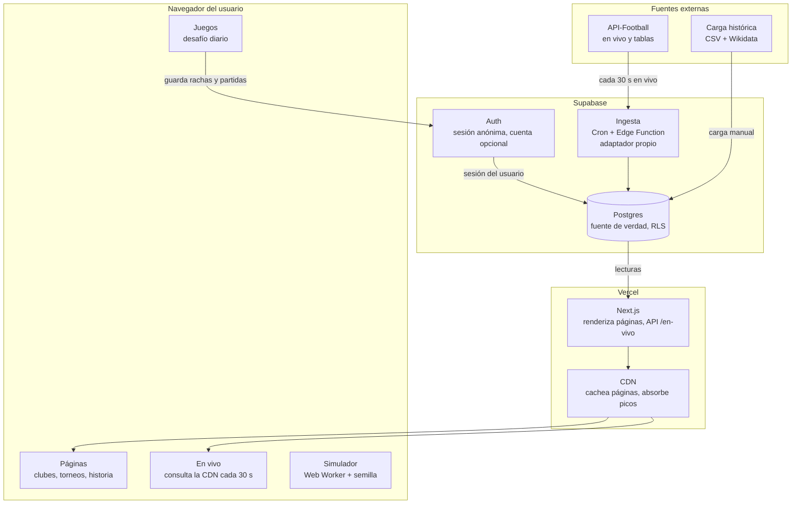

# Visión general de la arquitectura

Los usuarios leen de la CDN; solo la ingesta escribe datos de fútbol. Es un monolito modular: una app web Next.js más Supabase, con la lógica de fútbol en paquetes TypeScript que corren igual en la ingesta, el servidor y el navegador.

`packages/core` y `packages/simulator` son el mismo TypeScript en la ingesta, el servidor y el navegador.

## Decisiones de escalabilidad

- **Leer de caché, no de la base.** Las páginas de clubes, torneos e historia se renderizan una vez y se cachean; la historia casi no cambia. La base recibe una consulta cada tanto, no una por visita.
- **En vivo por consulta, no por conexión abierta.** El navegador pide `/api/en-vivo` cada 30 s y la CDN entrega la misma copia (vida de 15 s) a todos. Para la base, mil visitas y un millón cuestan lo mismo. Supabase Realtime (200 conexiones en Free, 500 en Pro) queda para cosas chicas como predicciones, usando Broadcast. Ver [ADR 0005](../decisiones/0005-en-vivo-por-consulta-cacheada.md).
- **El simulador corre en el navegador.** El ejemplo de la propuesta (4 divisiones de 20 equipos, 30 temporadas) son 45.600 partidos: menos de un segundo en un Web Worker, sin costo de servidor. Misma semilla y misma versión del motor dan el mismo resultado, así que compartir una simulación es guardar unos pocos KB de configuración. Ver [ADR 0004](../decisiones/0004-simulador-en-el-navegador.md).
- **Ingesta desacoplada.** El adaptador traduce cada proveedor a nuestro modelo y guarda los ids externos. Cambiar o sumar proveedor no toca ninguna pantalla. Ver [ADR 0003](../decisiones/0003-api-football-detras-de-adaptador.md).
- **Un solo escritor por tipo de dato.** Solo la ingesta y la carga histórica escriben datos de fútbol. Los usuarios escriben solo lo suyo (rachas, simulaciones), protegido por RLS.
- **Desafío diario pregenerado.** Un cron crea los desafíos de la semana por adelantado. La respuesta se valida en el servidor, así nadie hace trampa en el ranking mirando el código de la página.

## ¿Y el backend?

No hay un servidor aparte (Express o NestJS). El backend es Supabase (datos, cuentas, permisos, cron) más la capa servidor de Next.js (Route Handlers y Server Actions) más las funciones de ingesta. Si un día el simulador necesita correr en servidor, se extrae a un servicio: esa puerta queda abierta porque la lógica vive en paquetes, no en las pantallas. Ver [ADR 0001](../decisiones/0001-monolito-modular.md).
