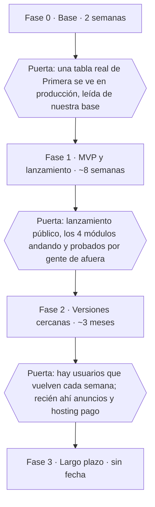

# Hoja de ruta

Cuatro fases; cada una termina con algo publicado, no con código a medias. Se pasa a la siguiente solo cuando se cumple su puerta. Las duraciones suponen unas 10 h por semana por persona: importa más el orden que las fechas.

| Fase | Qué incluye |
| --- | --- |
| **0 · Base** | Repo, CI, deploy y Supabase (dev y prod) funcionando. Esquema v0, relevamiento de cobertura de datos e identidad visual base. Checklist: [fase-0.md](fase-0.md) |
| **1 · MVP** | Primera y Nacional en vivo con tablas; 3 o 4 ligas de afuera. Perfiles básicos de clubes y campeones históricos de Primera. Un juego diario con rachas y cuentas opcionales. Simulador de la estructura real (Primera + Nacional) |
| **2 · Versiones cercanas** | Simulador personalizado y simulaciones compartidas por enlace. Comparador de clubes, predicciones y dos juegos más. Ascenso (B Metro, C, Federal A) según cobertura; más archivo |
| **3 · Largo plazo** | Comunidad con moderación y propuestas de formato votadas. Más ligas internacionales y torneos comunitarios |

## Fase 1 sprint por sprint

Cuatro sprints de 2 semanas. Cada fila es lo que cada dueño muestra en la demo de cierre.

| Sprint | Teby | Rama | Pela | Emi |
| --- | --- | --- | --- | --- |
| 1 | Motor de formatos en `core` (zonas, playoff, desempates) | Ingesta en vivo y fixtures de Primera y Nacional | Importador CSV y campeones de Primera | Motor de juegos y Adiviná el futbolista con datos de prueba |
| 2 | Simulador: partidos (Elo + Poisson) y una temporada | Páginas de torneo con tabla y fixture | Perfil de club: datos, títulos, historial | Desafío diario pregenerado y validado en el servidor |
| 3 | Varias temporadas con ascensos y descensos; cuentas con sesión anónima | Ligas de afuera y estadísticas de temporada | Página de historia por año | Rachas con cuenta y compartir resultado |
| 4 | Pantalla del simulador y home | Monitoreo de la ingesta y SEO | Ascensos y descensos históricos de Primera | Pulido visual de todo el sitio |

En el sprint 4, además, los 4 prueban el sitio con gente de afuera y arreglan lo que salga antes de lanzar.

## Qué queda fuera de la primera versión (a propósito)

- B Metro, C, Federal A y Regional Amateur: entran en Fase 2 según [la cobertura real](../datos/cobertura.md).
- Más de un juego: los otros dos llegan en Fase 2.
- Simulador personalizado y compartido: Fase 2.
- Comparador, predicciones, foro y propuestas de formato: Fases 2 y 3.
- Anuncios: no antes de la puerta de la Fase 2.
